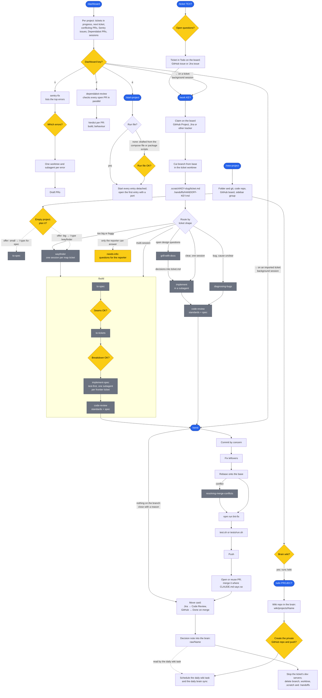

# skills

My Claude Code skills. Per ticket I type two commands, `/work` and `/send`;
everything in between runs on its own and stops only where I have to decide.

    /dashboard          full-screen, keyboard-driven: next tickets, ticket workflow, session tree
    /start-project      start the project's servers and containers, open it in the browser
    /new-project [NAME] set up a project: folder, code repo, board, sidebar group, optional wiki
    /wiki PROJECT       give a project a wiki in the brain, fed once a day
    /ticket TEXT        add a ticket to the project's board (GitHub or Jira)
    /work KEY           claim the ticket, pick a route (fix, grill, build, wayfinder), start it
    /build              spec → tickets → test-first build in subagents → review
    /send               commit, fix leftovers, rebase, lint, test, push, open the PR, move the board card

Built on Matt Pocock's skills (separate install): `/work`, `/build` and `/send`
hand off to his `to-spec`, `to-tickets`, `implement-spec`, `implement`, `wayfinder`,
`grill-with-docs`, `diagnosing-bugs`, `code-review` and `resolving-merge-conflicts`;
`/new-project` offers his `to-spec` and `wayfinder` for an empty project.

## Workflow

Blue: a command I type. Yellow: a point where the flow stops for my decision.
Grey: Matt Pocock's skills. Everything else runs on its own.

## Skills

| | Skill | What it does | Uses |
| --- | --- | --- | --- |
| **Daily** | `dashboard` | Starts my full-screen local dashboard (each project's state, ticket workflow, background sessions) and brings its window to the front. The app lives in its own repo, `dashboard`, under the projects root. | dashboard repo |
| | `start-project` | Starts every entry of the project's run file (`.claude/launch.json`: dev servers, containers) detached and opens the first entry's port in the browser. Without a run file it suggests one from the compose file or package scripts. A port another folder holds moves to a free one. The dashboard's "e" key runs it. | repo |
| **Ticket flow** | `ticket` | Adds one ticket to the project's board, in the language and pattern of the tickets already there: on GitHub an issue in the code repo, added to its Project (the id is the board's key and the issue number, `SKL-12`); on Jira a Jira issue. First asks what the text leaves open that would change the work. Given only an id, points to `/work`. | board (GitHub, Jira) |
| | `work` | Claims a ticket on the project's board (GitHub Project, Jira, or any tracker with a connector), cuts its branch, imports it, and starts the route that works on it. | board (GitHub, Jira, other), repo |
| | `build` | Runs a multi-session feature in one session: spec, tickets, test-first build in subagents, code review. | repo |
| | `send` | Ships the branch: commit, fix its own leftovers, rebase onto the base branch, lint, test, push, PR with the tracker link, board card moved, the ticket's decisions written into the brain as a decision note, the ticket's dev servers stopped, branch and worktree cleaned up. Names the other open PRs that now conflict. A ticket branch with nothing on it is closed instead: the ticket closes with the reason, same cleanup. | GitHub, board, repo, vault |
| **Maintenance** | `sentry-fix` | Fixes Sentry errors in their own worktrees and opens draft PRs; finds the Sentry projects from the DSNs in the code. Without short ids it lists the top three errors and waits for my pick. | Sentry, GitHub |
| | `dependabot-review` | Checks every open Dependabot PR in parallel: does it break the build, could it change behaviour. | GitHub |
| **Setup and misc** | `new-project` | Sets up a project: folder and git, code repo, GitHub board, sidebar group. Creates only what's missing. Offers `to-spec` or `wayfinder` for an empty project, and `/wiki` when the brain is a git repo. | GitHub, repo, vault |
| | `wiki` | Gives a project a wiki: a private repo of shared pages inside the brain, fed once a day from the project's notes. Schedules the wiki task and the daily brain sync. Creates only what's missing. | vault, GitHub |
| | `cv-update` | Weekly: checks my GitHub PRs and `/teach` lessons against my CV and asks before editing it. | GitHub |

## Install

    npx skills add mattpocock/skills   # required: the skills above hand off to these
    npx skills add QNeih/skills

These are written for my setup and meant to be read and adapted. They expect:
a GitHub Project per project, linked to its code repo, with the settings in the repo's `.claude/project.md` (Jira for projects that use it), an Obsidian vault (the brain, for `/wiki`),
`gh`, the Jira MCP server and `acli` where a project uses Jira,
and the `sentry` CLI where it uses Sentry.
Put your projects root and vault path in `~/.claude/CLAUDE.md`.
