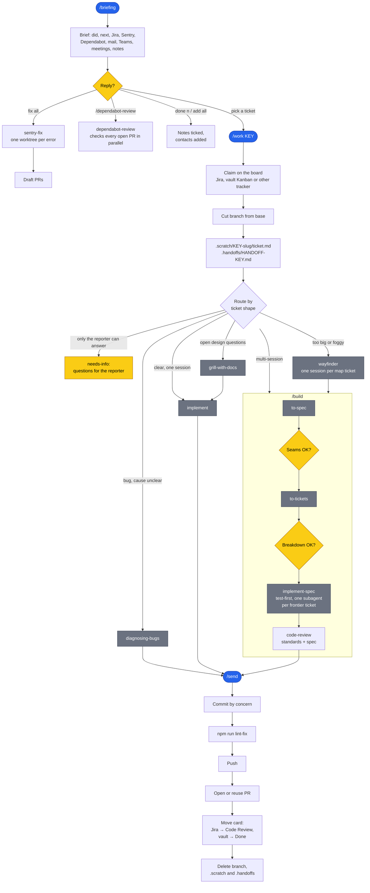

# skills

My Claude Code skills. Per ticket I type two commands, `/work` and `/send`;
everything in between runs on its own and stops only where I have to decide.

    /briefing     what's new or waiting on me, across all projects
    /dashboard    full-screen, keyboard-driven: next tickets, ticket workflow, session tree
    /ticket TEXT  add a card to the project's vault board
    /work KEY     claim the ticket, pick a route (fix, grill, build, wayfinder), start it
    /build        spec → tickets → test-first build in subagents → review
    /send         lint, commit, push, open the PR, move the board card

Built on Matt Pocock's skills (separate install): `/build` and `/work` hand off
to his `to-spec`, `to-tickets`, `implement-spec`, `implement`, `wayfinder`,
`grill-with-docs` and `diagnosing-bugs`.

## Workflow

Blue: a command I type. Yellow: a point where the flow stops for my decision.
Grey: Matt Pocock's skills. Everything else runs on its own.

## Skills

| | Skill | What it does | Uses |
| --- | --- | --- | --- |
| **Daily** | `briefing` | One whole-day briefing across every project: what I did last workday, what's next, Jira changes, new Sentry errors and Dependabot PRs, mail and Teams messages waiting on me, today's meetings. | vault, Jira, Sentry, GitHub, Microsoft 365 |
| | `dashboard` | Full-screen local web app: clock and Köln weather, then one project at a time beside a rail of project cards (open tickets, new Sentry errors, new Dependabot PRs; order saved): its next tickets with their sessions' state (running, waiting on you, archived), briefing to-dos and jumps, and each ticket's workflow, PR status and session tree. Keyboard-driven, no model calls. | vault, Claude app sessions, Jira, Sentry, GitHub, Open-Meteo |
| | `note` | Saves a to-do for the briefing, tagged with the project I'm in. | vault |
| **Ticket flow** | `ticket` | Adds one card to the project's vault board, in the language and line pattern of the cards already there, with the next free id. Given only an id, points to `/work`. | vault |
| | `work` | Claims a ticket on the project's board (Jira, an Obsidian Kanban board, or any tracker with a connector), cuts its branch, imports it, and starts the route that works on it. | board (vault, Jira, other), repo |
| | `build` | Runs a multi-session feature in one session: spec, tickets, test-first build in subagents, code review. | repo |
| | `send` | Ships the branch: lint, commit, push, PR with the tracker link, board card moved, branch cleaned up. | GitHub, board, repo |
| **Maintenance** | `sentry-fix` | Fixes Sentry errors in their own worktrees and opens draft PRs; finds the Sentry projects from the DSNs in the code. | Sentry, GitHub |
| | `dependabot-review` | Checks every open Dependabot PR in parallel: does it break the build, could it change behaviour. | GitHub |
| **Setup and misc** | `new-project` | Sets up a project: folder and git, project note, board, sidebar group, Fork workspace. Creates only what's missing. | vault, repo |
| | `add-context` | Files an interview, transcript or meeting notes into a project's `context/` folder by its `INDEX.md`, merges it to main, and tells the running sessions what changed. | repo |
| | `ask` | Answers questions about the codebase without changing files. | repo |
| | `cv-update` | Weekly: checks my GitHub PRs and `/teach` lessons against my CV and asks before editing it. | GitHub |

### Dashboard keys

`?` shows the same list inside the dashboard.

| Screen | Key | What it does |
| --- | --- | --- |
| home, ticket | `?` | toggle the key list (`esc` / `⌫` also close it) |
| | `tab` / `⇧tab` | next / previous project: opens the screen you were last on in it (home, or a ticket still on its home list); unsent prompt text stays |
| ticket | `esc` / `⌫` | back |
| start (clock) | any key or click | go to home |
| home | `↑` `↓` / `j` `k` | move ticket selection |
| | `space` | open selected ticket |
| | `→` | new session in the app with the selected ticket's next command prefilled: `/work <id>` until it is imported, then `/send` until it has a PR |
| | `⏎` | open the selected ticket with its next command in the prompt box to edit; `⏎` again starts it |
| | `b` | prompt box; `⏎` there starts a background session (`claude --bg`, auto mode) in the project's folder with the text as its prompt, without the app's link confirmation. `←` (empty) or `esc` closes |
| | `⇧↑` / `⇧↓` | move project up / down in the rail (order saved) |
| | `1`–`9` | open ticket 1–9 (in progress first, then to do) |
| | `s` | new session: fix new Sentry errors (when there are any) |
| | `d` | new session: Dependabot review (when there are new PRs) |
| | `r` | refresh briefing |
| | `c` | clock screen |
| | `n` | mark the note with the `n` badge done (press twice) |
| ticket | `↑` `↓` / `j` `k` | move session selection |
| | `space` | open the selected session in the app; no sessions yet: new session with `/work <id>` prefilled |
| | `←` | back, while the ticket has no live sessions |
| | `⏎` | prompt box with the next command; `⏎` there starts a new session with it, `←` while unchanged or `esc` closes |
| | `→` | while the ticket has no live sessions: the same prompt box |

## Install

    npx skills add mattpocock/skills   # required: the skills above hand off to these
    npx skills add QNeih/skills

These are written for my setup and meant to be read and adapted. They expect:
an Obsidian vault with one note per project, the Microsoft 365 connector
(`/briefing`), `gh`, the Jira MCP server and `acli` where a project uses Jira,
and the `sentry` CLI where it uses Sentry.
Put your projects root and vault path in `~/.claude/CLAUDE.md`.

## Extras

- **session-nav** (Claude desktop app only): a bar above the prompt with a
  dashboard button (Shift+Tab, Enter), a link back to the parent session and links to child
  sessions, labelled by ticket id.
  `/plugin marketplace add QNeih/skills`, then `/plugin install session-nav@quinn`.
- **break-reminder**: opens a small window every hour that reminds me to drink
  water and stretch; `/break` opens it right away.
  `/plugin install break-reminder@quinn`.
